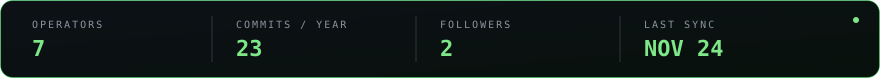
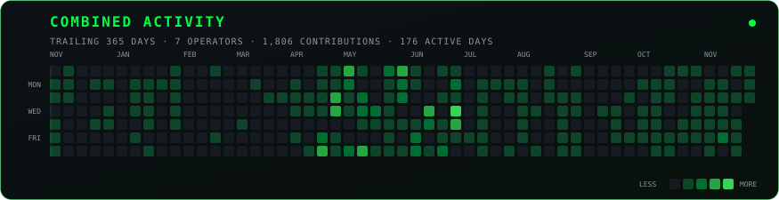

 

  

---

### Securing the physical world

We design, break, and harden the systems that critical infrastructure depends on: embedded
devices, industrial control networks, satellites, and the software supply chain behind them.
Our work spans applied cryptography, remote attestation, firmware analysis, intrusion
detection, and adversarial machine learning.

---

<!-- STATS:START -->

<!-- STATS:END -->

---

## // 01 · contribution leaderboard

<!-- LEADERBOARD:START -->

<table>
<tr>
<td align="center" width="33%">

 

 
<b><a href="https://github.com/atsana01">@atsana01</a></b>
 

 

 
<code>LEAD</code>
</td>
<td align="center" width="33%">

 

 
<b><a href="https://github.com/Slayingripper">@Slayingripper</a></b>
 

 

 
<code>ACTIVE</code>
</td>
<td align="center" width="33%">

 

 
<b><a href="https://github.com/tsekoss">@tsekoss</a></b>
 

 

 
<code>IDLE</code>
</td>
</tr>
<tr>
<td align="center" width="33%">

 

 
<b><a href="https://github.com/HafizMuhammadSobanKhan">@HafizMuhammadSobanKhan</a></b>
 

 

 
<code>IDLE</code>
</td>
<td align="center" width="33%">

 

 
<b><a href="https://github.com/drousias">@drousias</a></b>
 

 

 
<code>IDLE</code>
</td>
<td align="center" width="33%">

 

 
<b><a href="https://github.com/TheocharidesDimitris">@TheocharidesDimitris</a></b>
 

 

 
<code>IDLE</code>
</td>
</tr>
<tr>
<td width="33%"></td>
<td align="center" width="33%">

 

 
<b><a href="https://github.com/Michael-Photiades">@Michael-Photiades</a></b>
 

 

 
<code>IDLE</code>
</td>
<td width="33%"></td>
</tr>
</table>

<b>VELOCITY LEADER</b> &rarr; <a href="https://github.com/atsana01">@atsana01</a> · 3.87 commits/day 
<b>STREAK LEADER</b> &rarr; <a href="https://github.com/Slayingripper">@Slayingripper</a> · 8-day active streak

Metrics are computed from public contribution telemetry over the last 365 days. Private
contributions may be undercounted. Streaks count consecutive days with at least one commit.
Operators with no commits in the window are hidden.

<!-- LEADERBOARD:END -->

---

## // 02 · operator telemetry

<!-- ACTIVITY:START -->

Combined public contribution activity · 7 operators · trailing 365 days

<!-- ACTIVITY:END -->

---

## // 03 · research tracks

<table>
<tr>
<td align="center" width="33%">

<h3>Systems Security</h3>
Hardware &amp; firmware · TEEs · secure boot · remote attestation · embedded &amp; IoT
</td>
<td align="center" width="33%">

<h3>Network Security</h3>
CAN · Modbus · OPC-UA · MQTT · intrusion detection · segmentation · cyber ranges
</td>
<td align="center" width="33%">

<h3>AI Security</h3>
ML threat detection · adversarial ML · automated threat hunting · learning-enabled systems
</td>
</tr>
</table>

---

## // 04 · collaborate

We work with academic groups, industry partners, and students on funded research, thesis
projects, and joint publications.

  

---

<code>[EOF]</code> · connection closed · stay secure

